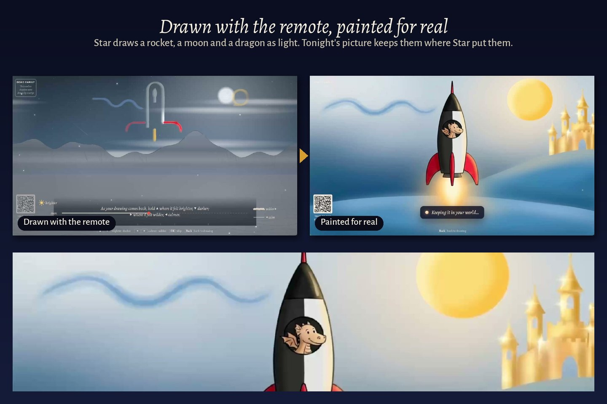

# Inkwash

**Kids watch other people's worlds all day. Inkwash lets them make their own:** draw it with the
Fire TV remote, hear it told back as a story, and keep a world that grows a piece at a time.

Our entry to the Amazon Developer Hackathon 2026, Fire TV track: a Vega OS app, with a story server
on AWS (AWS Lambda, Amazon Polly, DynamoDB), Claude as its storyteller and pictures from Google's
Gemini.

**Start here**

- **Watch:** the demo video is linked from our Devpost entry.
- **Try it in a few minutes, with no keys and no cost** (Node 20 or later, two terminals):

  ```sh
  cd tv && npm install && npm start                      # the TV page on http://localhost:5180
  cd tv/server && npm install && npm run stand-in        # a scripted storyteller on http://localhost:5188
  ```

  Then open `http://localhost:5180/?guide=http://localhost:5188&demo`. Arrows move, Enter is OK, Esc
  is Back, P is play/pause. [`TESTING.md`](TESTING.md) has what to try, and how to install it on a
  Fire TV.
- **See how it's built:** the diagram under *How it's built*, then [`tv/README.md`](tv/README.md).



## What it does

- **The remote is a brush.** It draws straight into your world, in lines of light. Two buttons say
  how it felt: brighter or darker, calmer or wilder.
- **A storyteller tells it back.** Claude Opus 5.5 (through Anthropic's API, or on Amazon Bedrock) sees the drawing as you see
  it, asks a question or two (answer on your phone, or with the remote), and tells it as a story, a
  line at a time, read aloud by Amazon Polly. ▲ keeps a line; ▼ says "not quite" and hears it
  another way at once.
- **It wakes up in its place.** The Set Designer writes where your world stands from its story, and
  an image model (Gemini 3 Pro Image) paints it, and each thing in it, keeping to the layout you
  drew. Once their world has settled, the place and the things in it are painted again as one
  picture, so each thing belongs in the place rather than sitting on it. We built the pictures on Amazon Nova Canvas, which AWS retired on 30 September 2026, so the
  server now asks Gemini for the same pictures.
- **Then more, when you want it.** *See all around it*, a panorama to look across; *Paint it again* in another look; *Walk inside*, a 3D
  world built from the picture (World Labs); *Step inside*, the drawing opening like a pop-up book.
- **It remembers.** Come back another day and it opens like a series: *Previously in Star's
  world*. Draw the rocket again and it asks whether it's the same rocket, with Tuesday's drawing
  beside tonight's. *What happens next?* lets you draw the story on.
- **A family shares one TV.** Each person has a seal and a world of their own, a grown-up's or a
  child's, and a thing from one world can visit another's.
- **It forgets exactly what you ask.** *Forget* a thing and it goes, with everything that grew from
  it, and nothing else does.
- **Or write it instead.** No time to draw with a remote? *Write a story instead*: say it on your
  phone or pick an idea, and it's told back and painted from your words.
- **Each world opens on its map**, a hand-inked atlas of everything drawn in it; OK flies in.

## A prompt can ask; code can promise

Before anything reaches the screen, each line of a telling must come from something of theirs:
their words, their answers, a thing in their world, or how they drew it. A child's telling is
checked line by line: nothing frightening they didn't bring, nothing they marked darker made
bigger, no figure of speech they might take literally. A telling that fails is sent back once
with the reason. Paid requests are keyed so the same one is never paid twice, and the server stops
at a daily spending limit. Their worlds stay on their TV.

## Try it

- **In a browser, without AWS:** the two commands under *Start here*. The storyteller is a scripted
  stand-in, so it costs nothing and makes no pictures.
- **On a Fire TV:** [`TESTING.md`](TESTING.md).
- **With the real storyteller:** deploy the story server to your own AWS account (`sam deploy`,
  with an Anthropic API key and a Gemini API key), as [`tv/README.md`](tv/README.md) describes under
  *Deploying the story server*.

## How it's built


| Folder | What |
| --- | --- |
| [`tv/`](tv) | The TV app: one 1920 × 1080 page drawn on the GPU, run by the Vega app. [`tv/README.md`](tv/README.md) is the full account: what it does, how, and what it costs |
| [`tv/server/`](tv/server) | The story server: one AWS Lambda behind a function URL (an AWS SAM template), its agents, its checks and its limits, with stand-ins for every paid service |
| [`tv/vega/`](tv/vega) | The Vega OS app: a React Native WebView around the packaged page, with the remote's keys passed through |
| [`engine/`](engine) | The memory under it: a world-state engine (who is who, what is true when, what each line relied on) and each person's dream world. The TV and the server carry copies of it, kept in step by a test |
| [`tv/FRICTION_LOG.md`](tv/FRICTION_LOG.md) | What got in our way building on Vega OS and AWS, and what we would ask for |
| [`tv/docs/gallery/simulator/`](tv/docs/gallery/simulator) | Recorded in the Vega Virtual Device with the deployed story server; [`tv/docs/gallery/`](tv/docs/gallery), the TV page in Chromium |

## Tests

```sh
cd tv && npm install && npm test && npm run e2e   # 99 unit tests; 34 browser steps at 1920 x 1080
cd server && npm install && npm test              # 103 tests of the story server
cd ../../engine && node --test test.mjs personal/test.mjs dreams/test.mjs   # 93 tests of the engine
```

The browser steps drive the real page with simulated remote keys, against the story server's own
code with a script standing in for Claude. `npm run e2e:bundle` runs them again on the packaged
single file, opened from `file://` as the Vega app loads it. Among the server's tests, the deployed
path runs end to end: the real Lambda handler, Anthropic SDK and Gemini client, with only the two
APIs faked at the network, each turning away what the real one would.

## What has run, and what hasn't

- **Run in the Vega Virtual Device** (on an Apple Silicon Mac, 22 and 23 October): the release
  package installed and launched with the Vega CLI, driven with the remote's buttons through the
  device's own input tool, and recorded for the demo video.
- **Live from the deployed story server:** Claude's tellings, questions and places, through
  Anthropic's API; Google Gemini's pictures (a drawing made real, each thing, a world painted as one,
  a panorama, a story's picture from words alone); and Amazon Polly's voice.
- **Not run yet:** Amazon Bedrock. The storyteller is written for it, but Bedrock's models weren't
  open to our new AWS account, so it calls Anthropic's API instead; moving fully onto Bedrock is
  next. *Walk inside* (a World Labs world) built from the TV's picture but drew black in the
  simulator, and hasn't been tried on a Fire TV stick. *Watch it come alive* is off: AWS retired
  Amazon Nova Reel. Nothing has run on a physical Fire TV stick yet.

## Licence

MIT ([`LICENSE`](LICENSE)). The fonts in [`tv/fonts`](tv/fonts) keep their SIL Open Font
Licence, and qrcode-generator in `tv/src/vendor` its MIT licence.
