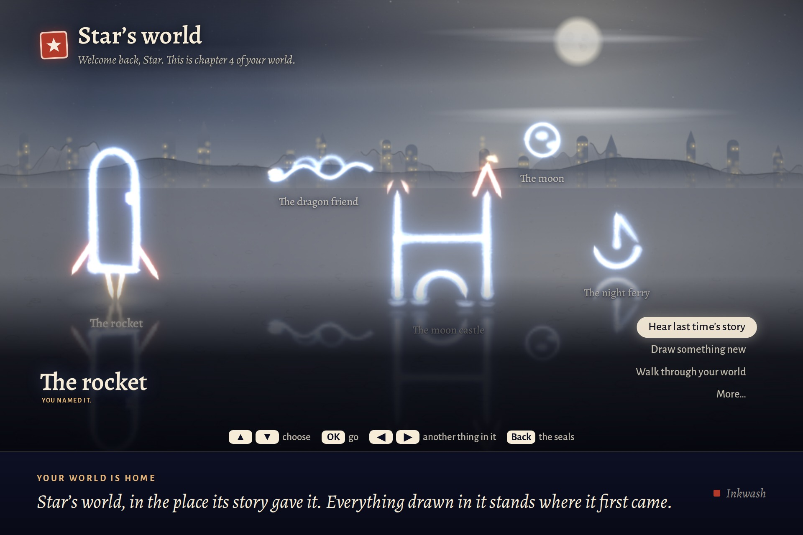
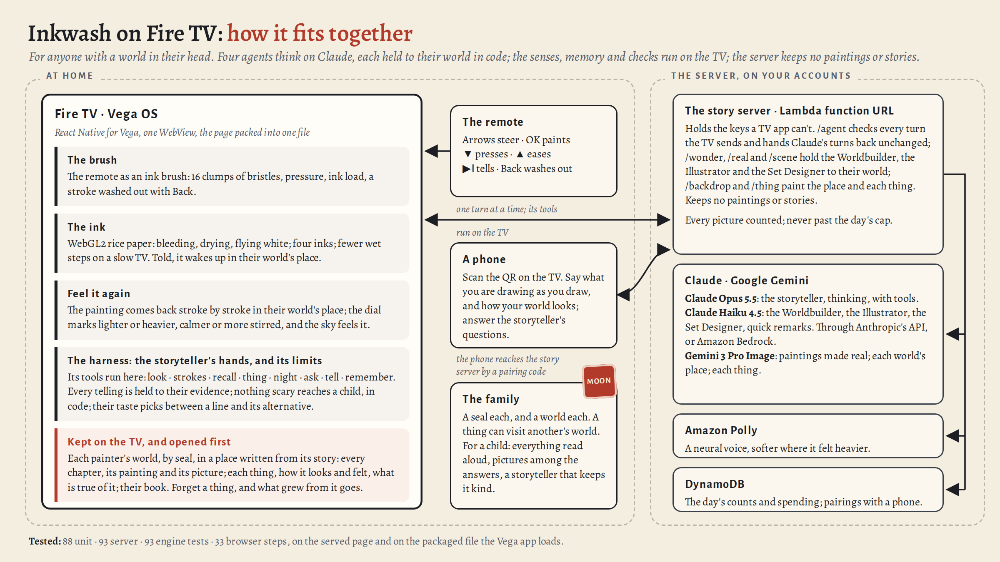

# Inkwash

**Draw the world in your head with the Fire TV remote.** A storyteller tells each drawing back as a
story, it wakes up in a place made from that story, and your world grows a piece at a time.

Our entry to the Amazon Developer Hackathon 2026, Fire TV track: a Vega OS app, with a story server
on AWS (Amazon Bedrock, Amazon Nova Canvas and Nova Reel, Amazon Polly, AWS Lambda, DynamoDB, S3).



## What it does

- **The remote is a brush.** It draws straight into your world, in lines of light. Two buttons say
  how it felt: brighter or darker, calmer or wilder.
- **A storyteller tells it back.** Claude Opus 5.5 on Amazon Bedrock sees the drawing as you see
  it, asks a question or two (answer on your phone, or with the remote), and tells it as a story, a
  line at a time, read aloud by Amazon Polly. ▲ keeps a line; ▼ says "not quite" and hears it
  another way at once.
- **It wakes up in its place.** The Set Designer writes where your world stands from its story, and
  Amazon Nova Canvas paints it, and each thing in it, held to the shapes you drew.
- **Then more, when you want it.** *Watch it come alive* (Amazon Nova Reel, six seconds); *See all
  around it*, a panorama to look across; *Paint it again* in another look; *Walk inside*, a 3D
  world built from the picture (World Labs); *Step inside*, the drawing opening like a pop-up book.
- **It remembers.** Come back another day and it opens like a series: *Previously in Star's
  world*. Draw the rocket again and it asks whether it's the same rocket, with Tuesday's drawing
  beside tonight's. *What happens next?* lets you draw the story on.
- **A family shares one TV.** Each person has a seal and a world of their own, a grown-up's or a
  child's, and a thing from one world can visit another's.
- **It forgets exactly what you ask.** *Forget* a thing and it goes, with everything that grew from
  it, and nothing else does.

## A prompt can ask; code can promise

Before anything reaches the screen, each line of a telling must come from something of theirs:
their words, their answers, a thing in their world, or how they drew it. A child's telling is
checked line by line: nothing frightening they didn't bring, nothing they marked darker made
bigger, no figure of speech they might take literally. A telling that fails is sent back once
with the reason. Paid requests are keyed so the same one is never paid twice, and the server stops
at a daily spending limit. Their worlds stay on their TV.

## Try it

- **On a Fire TV, or in a browser without AWS:** [`TESTING.md`](TESTING.md). The browser version
  takes about five minutes with Node 20 or later, and uses a scripted stand-in for the storyteller,
  so it costs nothing.
- **With the real storyteller:** deploy the story server to your own AWS account (`sam deploy`),
  as [`tv/README.md`](tv/README.md) describes under *Deploying the story server*.

## How it's built



| Folder | What |
| --- | --- |
| [`tv/`](tv) | The TV app: one 1920 × 1080 page drawn on the GPU, run by the Vega app. [`tv/README.md`](tv/README.md) is the full account: what it does, how, and what it costs |
| [`tv/server/`](tv/server) | The story server: one AWS Lambda behind a function URL (an AWS SAM template), its agents, its checks and its limits, with stand-ins for every paid service |
| [`tv/vega/`](tv/vega) | The Vega OS app: a React Native WebView around the packaged page, with the remote's keys passed through |
| [`engine/`](engine) | The memory under it: a world-state engine (who is who, what is true when, what each line relied on) and each person's dream world. The TV and the server carry copies of it, kept in step by a test |
| [`tv/FRICTION_LOG.md`](tv/FRICTION_LOG.md) | What got in our way building on Vega OS and AWS, and what we would ask for |
| [`tv/docs/gallery/`](tv/docs/gallery) | The TV's own screens, taken with the real storyteller |

## Tests

```sh
cd tv && npm install && npm test && npm run e2e   # 86 unit tests; 33 browser steps at 1920 x 1080
cd server && npm install && npm test              # 80 tests of the story server
cd ../../engine && node --test test.mjs personal/test.mjs dreams/test.mjs   # 93 tests of the engine
```

The browser steps drive the real page with simulated remote keys, against the story server's own
code with a script standing in for Claude. `npm run e2e:bundle` runs them again on the packaged
single file, opened from `file://` as the Vega app loads it.

## What hasn't been tried yet

- **No paid call has been made from the TV.** The real storyteller and Worldbuilder have told 24
  worlds through Claude Code on a Claude subscription, but never through Amazon Bedrock, and no
  real picture, clip, panorama or World Labs world has been made: the tests use stand-ins.
- **The Vega app has not run on a device.** It builds for the Vega Virtual Device and for Fire TV
  sticks, but our build machine had no hardware acceleration (KVM), and the simulator runs a
  WebView app only on an Apple Silicon Mac, so everything was tested in Chromium at 1920 × 1080
  with the remote's keys.

## Licence

MIT ([`LICENSE`](LICENSE)). The fonts in [`tv/fonts`](tv/fonts) keep their SIL Open Font
Licence, and qrcode-generator in `tv/src/vendor` its MIT licence.
